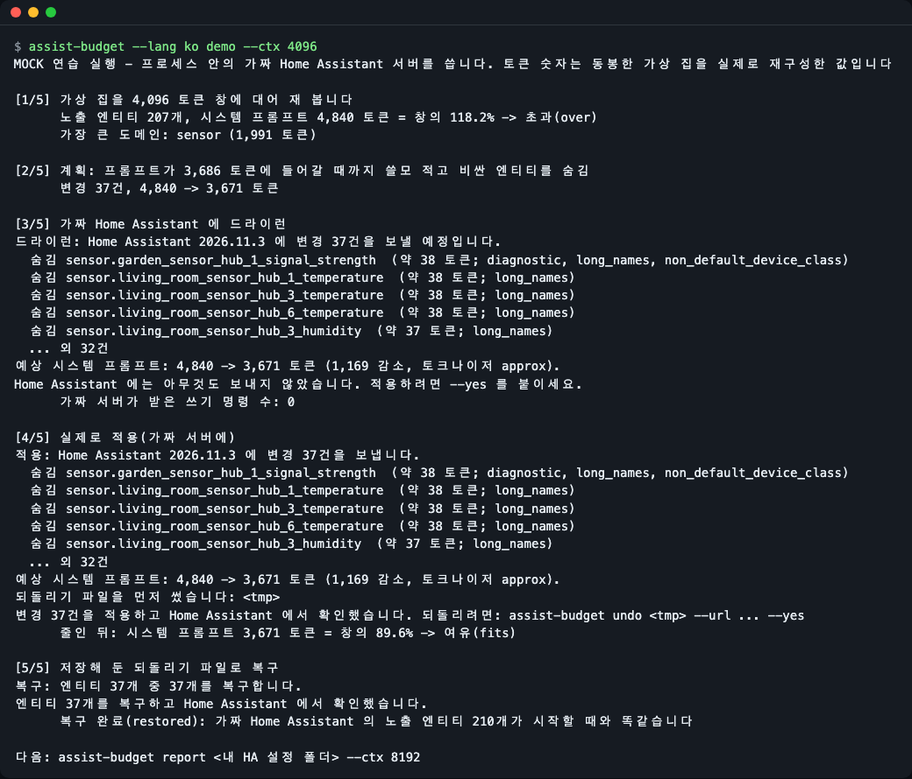
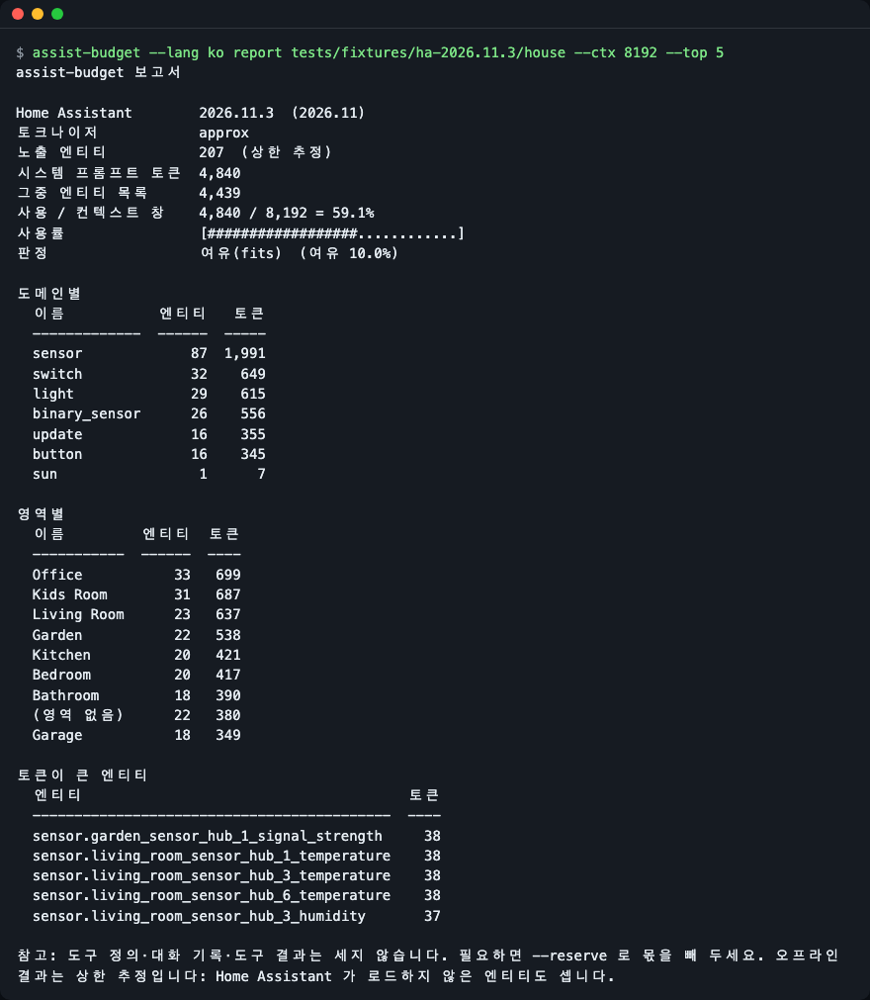
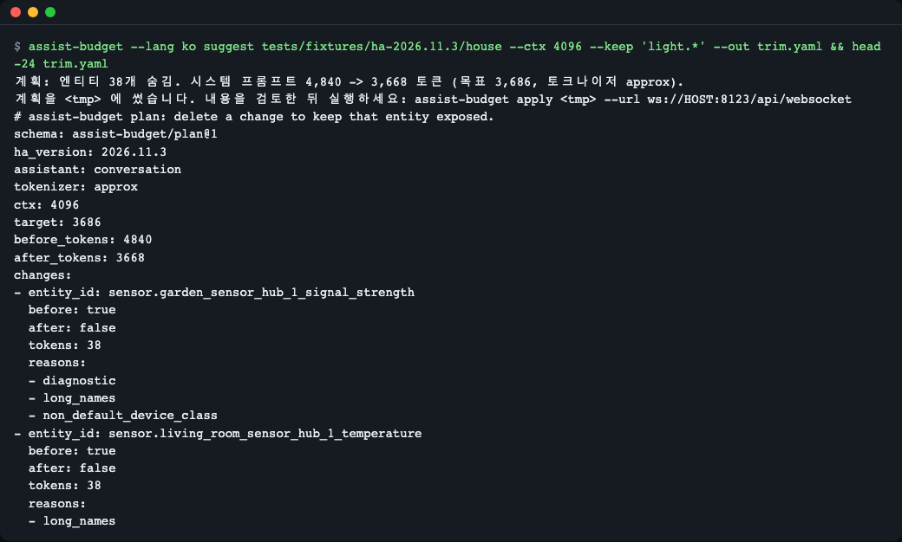
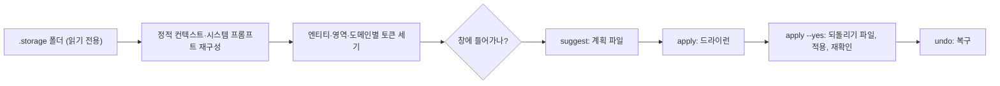

# assist-budget

[English](README.md) | **한국어**

Home Assistant Assist 가 LLM 에 보내는 프롬프트를 재서, 어떤 엔티티가 컨텍스트 창을 차지하는지 보고, 드라이런과 되돌리기 파일로 안전하게 줄입니다.


*내장 연습 실행(목 모드): 프롬프트가 4,096 토큰 창을 넘고, 줄여서 맞춘 뒤, 원래대로 복구합니다.*

Home Assistant Assist 에 LLM(Ollama, OpenAI 등)을 붙이면 노출된 엔티티가 전부 시스템 프롬프트에 들어갑니다. 기기가 늘면 프롬프트가 모델의 컨텍스트 창을 넘칩니다. `assist-budget` 은 Home Assistant 의 `.storage` 폴더(읽기만 함)에서 그 프롬프트를 다시 만들고, 엔티티·영역·도메인별 토큰을 세고, 숨길 엔티티 계획을 만들어 안전하게 적용합니다.

## 이런 분께

- 로컬 모델(예: Ollama `num_ctx` 8192)로 Assist 를 쓰는데 모델이 엔티티를 줄줄 읊거나 엉뚱하게 답하는 분
- 토큰 단위로 요금을 내서 엔티티 목록 비용이 궁금한 분
- 기기를 새로 들인 뒤 프롬프트가 아직 들어가는지 빨리 확인하고 싶은 분

## 설치

Python 3.11 이상이 필요합니다. [uv](https://docs.astral.sh/uv/) 로 실행하는 것이 가장 쉽습니다(`curl -LsSf https://astral.sh/uv/install.sh | sh`).

```bash
git clone https://github.com/LeeGyeongPil/assist-budget
cd assist-budget
uv run assist-budget --version
```

```text
assist-budget 0.1.0
```

PyPI 에 올라가면 `pip install assist-budget` 도 됩니다. 정확한 토큰 계산(선택): `pip install 'assist-budget[tekken]'`, clone 해서 쓰면 `uv run --extra tekken assist-budget ...`.

## 빠르게 시작하기

Home Assistant·토큰·네트워크가 필요 없습니다. **연습용 목(mock) 모드**입니다. 토큰 숫자는 동봉한 가상 집(Home Assistant 2026.11.3 이 합성 데이터로 쓴 파일)을 실제로 재구성해 센 값이지만, 대화 상대인 Home Assistant 서버는 프로세스 안의 가짜입니다.

```bash
uv run assist-budget --lang ko demo --ctx 4096
```

```text
MOCK 연습 실행 - 프로세스 안의 가짜 Home Assistant 서버를 씁니다. 토큰 숫자는 동봉한 가상 집을 실제로 재구성한 값입니다

[1/5] 가상 집을 4,096 토큰 창에 대어 재 봅니다
      노출 엔티티 207개, 시스템 프롬프트 4,840 토큰 = 창의 118.2% -> 초과(over)
      가장 큰 도메인: sensor (1,991 토큰)

[2/5] 계획: 프롬프트가 3,686 토큰에 들어갈 때까지 쓸모 적고 비싼 엔티티를 숨김
      변경 37건, 4,840 -> 3,671 토큰

[3/5] 가짜 Home Assistant 에 드라이런
드라이런: Home Assistant 2026.11.3 에 변경 37건을 보낼 예정입니다.
  ...
Home Assistant 에는 아무것도 보내지 않았습니다. 적용하려면 --yes 를 붙이세요.
      가짜 서버가 받은 쓰기 명령 수: 0

[4/5] 실제로 적용(가짜 서버에)
  ...
      줄인 뒤: 시스템 프롬프트 3,671 토큰 = 창의 89.6% -> 여유(fits)

[5/5] 저장해 둔 되돌리기 파일로 복구
복구: 엔티티 37개 중 37개를 복구합니다.
엔티티 37개를 복구하고 Home Assistant 에서 확인했습니다.
      복구 완료(restored): 가짜 Home Assistant 의 노출 엔티티 210개가 시작할 때와 똑같습니다
```

(`...` 로 줄였습니다. 실제 출력에는 엔티티 목록이 나옵니다.) 실제 모드와 다른 점은 서버뿐입니다. `apply`·`undo` 는 내 Home Assistant 와 통신하며 토큰이 필요합니다.

## 내 Home Assistant 에 쓰기

### 1. 설정 폴더 찾기

`.storage` 가 들어 있는 폴더입니다. Home Assistant OS 는 Samba·SSH 애드온(`/config`), Docker 는 `/config` 로 연결한 볼륨, Core 는 `~/.homeassistant`. 불안하면 폴더를 복사해 두세요. 이 도구는 파일을 읽기만 합니다.

### 2. 재기

```bash
uv run assist-budget --lang ko report tests/fixtures/ha-2026.11.3/house --ctx 8192
```

경로는 내 폴더로 바꾸세요. 아래 예시는 동봉한 테스트용 집입니다.


*`report`: 사용률 막대, 판정, 도메인·영역·엔티티별 토큰.*

```text
assist-budget 보고서

Home Assistant        2026.11.3  (2026.11)
토크나이저            approx
노출 엔티티           207  (상한 추정)
시스템 프롬프트 토큰  4,840
그중 엔티티 목록      4,439
사용 / 컨텍스트 창    4,840 / 8,192 = 59.1%
사용률                [##################............]
판정                  여유(fits)  (여유 10.0%)
```

판정: `fits`(여유 있게 들어감), `tight`(여유 폭 안쪽으로 빠듯함), `over`(초과). 요약 아래에 도메인별(여기서는 `sensor` 87개 1,991 토큰)·영역별·비싼 엔티티 표가 나옵니다.

### 3. 계획 만들기

```bash
uv run assist-budget --lang ko suggest tests/fixtures/ha-2026.11.3/house --ctx 4096 --keep 'light.*' --out trim.yaml
```

```text
계획: 엔티티 38개 숨김. 시스템 프롬프트 4,840 -> 3,668 토큰 (목표 3,686, 토크나이저 approx).
계획을 trim.yaml 에 썼습니다. 내용을 검토한 뒤 실행하세요: assist-budget apply trim.yaml --url ws://HOST:8123/api/websocket
```


*`suggest`: 계획 파일의 변경마다 토큰 비용과 고른 이유가 적힙니다.*

계획은 YAML 파일입니다. 그대로 두고 싶은 엔티티의 변경 항목을 지우세요. 같은 입력이면 항상 같은 바이트가 나옵니다.

### 4. 드라이런, 적용, 되돌리기

```bash
export HA_TOKEN=...   # 관리자 장기 액세스 토큰
uv run assist-budget apply trim.yaml --url ws://homeassistant.local:8123/api/websocket          # 드라이런
uv run assist-budget apply trim.yaml --url ws://homeassistant.local:8123/api/websocket --yes    # 실제 적용
uv run assist-budget undo undo-<시각>.yaml --url ws://homeassistant.local:8123/api/websocket --yes
```

`--yes` 가 없으면 아무것도 쓰지 않습니다. `--yes` 면 Home Assistant 버전을 확인하고, 계획 이후 엔티티가 바뀌었으면 거부(종료 코드 5)하고, 되돌리기 파일을 **먼저** 쓰고, 적용한 뒤 다시 읽어 확인합니다. 위 데모가 가짜 서버로 이 흐름을 보여 줍니다.

## 옵션

| 명령 | 하는 일 | 예 |
|---|---|---|
| `report PATH` | 프롬프트를 다시 만들고 토큰을 셈 | `report ~/homeassistant --ctx 8192` |
| `report --reserve N` | 도구 정의·대화 기록 몫으로 토큰을 따로 떼어 둠(이 도구는 세지 않음) | `--reserve 1500` |
| `report --margin P` | 안전 여유 퍼센트(기본 10) | `--margin 15` |
| `report --tokenizer tekken` | Mistral 계열에 더 가까운 오프라인 계산기(extra 필요) | `--tokenizer tekken` |
| `report --format table\|json\|md` | 출력 형식 | `--format json` |
| `report --fail-over` | 판정이 `over` 면 종료 코드 1(스크립트·CI 용) | `--fail-over` |
| `report --instructions FILE` | 기본 지시문 대신 내 에이전트 지시문을 셈 | `--instructions mine.txt` |
| `suggest --target N` | 목표 토큰(기본: ctx·여유·reserve 로 계산) | `--target 3500` |
| `suggest --keep GLOB` / `--drop GLOB` | 맞는 엔티티를 절대 숨기지 않음 / 항상 숨김(반복 가능) | `--keep 'light.*'` |
| `apply FILE [--yes] [--force]` | 기본은 드라이런, `--force` 는 "계획 이후 변경됨" 검사를 무시 | `apply trim.yaml --yes` |
| `undo FILE [--yes]` | 저장된 노출 상태로 복구 | `undo undo-....yaml --yes` |
| `demo` | 목 연습 실행 | `demo --ctx 4096` |

종료 코드: 0 정상, 1 `--fail-over` 에서 판정 `over`, 2 입력 오류·선택 의존성 없음, 3 지원하지 않는 Home Assistant 버전·형식, 4 연결 실패 또는 쓰기 가능 범위 밖 버전, 5 계획 이후 노출 상태가 바뀜.

`suggest` 의 줄이기 규칙(이유가 하나라도 있으면 후보이고, 비싼 것부터 목표에 닿을 때까지 숨김): `diagnostic`(엔티티 카테고리 있음), `no_area`, `duplicate_name`, `long_names`(60자 초과), `non_default_domain`, `non_default_device_class`. `--keep` 이 항상 이깁니다.

## 설정

| 설정 | 뜻 |
|---|---|
| `HA_TOKEN` | 장기 액세스 토큰, `apply`·`undo` 에만 필요. 변수 이름은 `--token-env` 로 바꿀 수 있음. 출력·파일에 쓰지 않음. `.env.example` 참고. |
| `ASSIST_BUDGET_LANG` | 출력 언어 `en` 또는 `ko`. |
| `--lang en\|ko` | 출력 언어. 변수보다 우선. 순서: `--lang`, `ASSIST_BUDGET_LANG`, `LC_ALL`, `LC_MESSAGES`, `LANG`, `ko` 로 시작하지 않으면 영어. `--lang` 은 하위 명령 앞에 둡니다. |

## 지원 버전

지원하는 Home Assistant 버전:

| 버전 | 프로필 | 상태 |
|---|---|---|
| 2025.5 미만 | 없음 | 종료 코드 3 |
| 2025.5 - 2026.7 | `2025.5-2026.7` | "unverified profile" 경고 |
| 2026.8 - 2026.10 | `2026.8-2026.10` | "unverified profile" 경고 |
| 2026.11.x | `2026.11` | Home Assistant 2026.11.3 출력과 바이트 단위로 일치 검증 |
| 2026.11 이후 | 가장 가까운 프로필 | 경고 |

## 동작 원리



- `.storage` 의 레지스트리를 읽어 Home Assistant 가 만드는 방식(이름·영역·별칭·기본 노출 규칙)대로 엔티티 목록을 다시 계산합니다. 테스트에서 실제 Home Assistant 2026.11.3 의 출력과 비교합니다.
- 토큰은 엔티티 줄마다 셉니다. 기본 계산기 `approx` 는 글자 수를 4로 나눈 값입니다. 가상 집에서 `tekken` 계산기는 5,382, `approx` 는 4,840 으로 약 10% 적게 셉니다. 기본 여유가 10% 인 이유입니다. 한국어 이름이 많으면 `approx` 는 더 적게 세므로 `--tokenizer tekken` 이나 더 큰 여유를 쓰세요.
- 오프라인 결과는 상한 추정입니다. Home Assistant 가 로드하지 않은 엔티티도 세기 때문입니다.
- 변경은 Home Assistant WebSocket 의 `homeassistant/expose_entity` 명령으로 보냅니다. 공식 문서에 없는 명령이라 `apply` 는 기본이 드라이런이고 버전 범위(2024.6 ~ 2026.11)를 검사합니다.

## 언제 쓰나

- 이럴 때: 기본 Assist 설정을 그대로 쓰면서 토큰 비용을 알고 안전하게 줄이고 싶을 때.
- 이럴 땐 다른 도구: 모델이 엔티티를 전부 읊는 대신 도구로 찾게 하려면 [MCP Assist](https://github.com/mike-nott/mcp-assist), 손으로 노출을 고치려면 Home Assistant 의 노출 화면.

## 자주 겪는 문제

| 증상 | 원인 | 해결 |
|---|---|---|
| `Environment variable HA_TOKEN is empty`(종료 2) | `apply`·`undo` 는 토큰이 필요 | 프로필에서 장기 액세스 토큰을 만들고 `export HA_TOKEN=...` |
| 종료 코드 5 | 계획 이후 노출이 바뀌었거나, 기본 규칙으로만 노출되고 아직 저장되지 않은 엔티티 | `suggest` 를 다시 실행, 확실하면 `--force` |
| 종료 코드 3 | 2025.5 보다 오래된 버전이거나 알 수 없는 형식 | Home Assistant 업데이트 |
| "unverified profile" 경고 | 2026.11 만 바이트 단위로 검증됨 | 숫자를 추정치로 보고 여유를 유지 |
| `--tokenizer tekken` 이 종료 2 | 선택 extra 없음 | `pip install 'assist-budget[tekken]'`, clone 이면 `uv run --extra tekken assist-budget report ... --tokenizer tekken` |
| 의도치 않게 한국어로 나옴 | `LANG` 이 한국어 | `--lang en` 추가 (하위 명령 앞에: `assist-budget --lang en demo`) |

## 안전

- `.storage` 는 읽기 전용으로만 열며, `report`·`suggest` 는 아무것도 바꾸지 않습니다.
- `apply` 는 `--yes` 가 없으면 드라이런이고, 되돌리기 파일을 먼저 쓰며 `undo` 로 복원합니다.
- 토큰은 `HA_TOKEN` 에서만 읽고 출력·파일에 쓰지 않습니다. `ws://` 는 암호화 없이 보내므로 믿을 수 있는 LAN 밖에서는 `wss://` 를 쓰세요. [SECURITY.md](SECURITY.md) 참고.

## 한계

`report` 는 도구 정의·대화 기록·도구 결과를 세지 않습니다(`--reserve` 사용). `--instructions` 를 주지 않으면 기본 대화 지시문만 셉니다.

## 개발

```bash
uv run pytest -q
```

버그·제안은 이슈로 남겨 주세요. 변경 기록은 [CHANGELOG.md](CHANGELOG.md).

## 라이선스

MIT. 동봉한 프롬프트 문구와 기본 노출 규칙은 [Home Assistant core](https://github.com/home-assistant/core)(Apache License 2.0)에서 가져왔습니다. [NOTICE](NOTICE) 참고.
