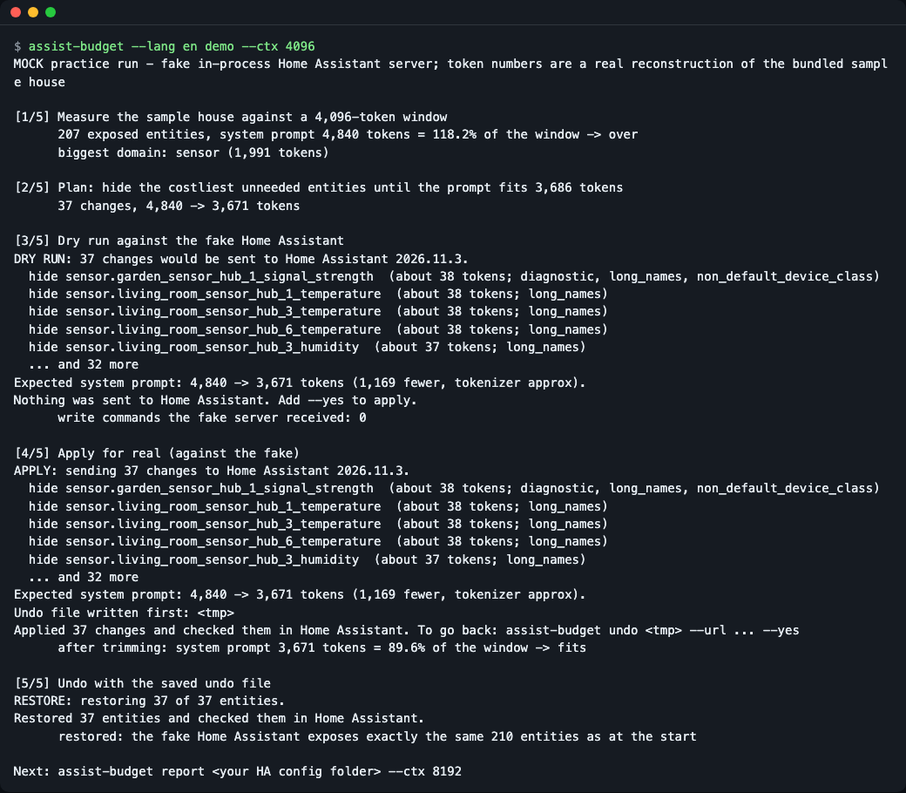
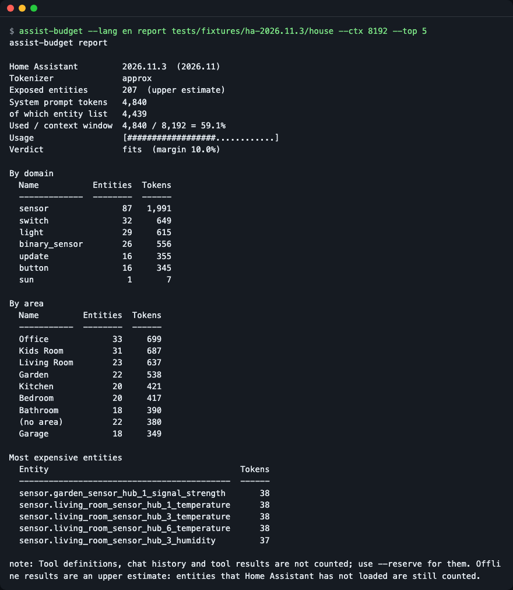
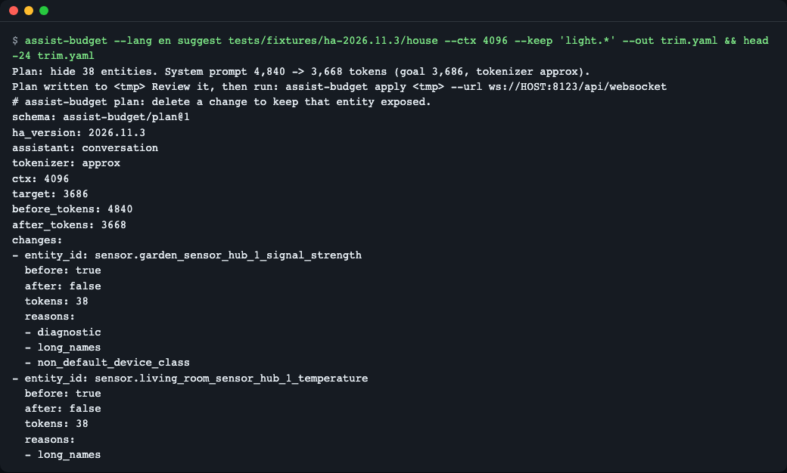
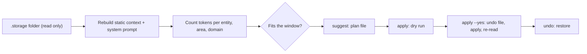

# assist-budget

**English** | [한국어](README.ko.md)

Measure what Home Assistant Assist sends to your LLM, see which entities eat the context window, and trim the list with a dry run and an undo file.


*The built-in practice run (mock mode): the prompt is over a 4,096-token window, gets trimmed, and is restored.*

When you plug an LLM (Ollama, OpenAI, ...) into Home Assistant Assist, every exposed entity is written into the system prompt. Add enough devices and the prompt no longer fits the model's context window. `assist-budget` rebuilds that prompt from your Home Assistant `.storage` folder (read-only), counts tokens per entity, area and domain, writes a plan of entities to hide, and applies it safely.

## Who it is for

- You run Assist with a local model (for example Ollama `num_ctx` 8192) and the model starts listing entities or answering wrongly.
- You pay per token and want to know what the entity list costs.
- You added new devices and want a quick check that the prompt still fits.

## Install

Requires Python 3.11 or newer. [uv](https://docs.astral.sh/uv/) is the easiest way to run it (`curl -LsSf https://astral.sh/uv/install.sh | sh`).

```bash
git clone https://github.com/LeeGyeongPil/assist-budget
cd assist-budget
uv run assist-budget --version
```

```text
assist-budget 0.1.3
```

Once the package is on PyPI you can also use `pip install assist-budget`. Optional exact token counting: `pip install 'assist-budget[tekken]'`, or from a clone `uv run --extra tekken assist-budget ...`.

## Quick start

No Home Assistant, token or network needed. This is a **mock practice run**: the token numbers are a real reconstruction of a bundled sample house (written by Home Assistant 2026.11.3 from synthetic data), but the Home Assistant server it talks to is a fake one inside the process.

```bash
uv run assist-budget --lang en demo --ctx 4096
```

```text
MOCK practice run - fake in-process Home Assistant server; token numbers are a real reconstruction of the bundled sample house

[1/5] Measure the sample house against a 4,096-token window
      207 exposed entities, system prompt 4,840 tokens = 118.2% of the window -> over
      biggest domain: sensor (1,991 tokens)

[2/5] Plan: hide the costliest unneeded entities until the prompt fits 3,686 tokens
      37 changes, 4,840 -> 3,671 tokens

[3/5] Dry run against the fake Home Assistant
DRY RUN: 37 changes would be sent to Home Assistant 2026.11.3.
  ...
Nothing was sent to Home Assistant. Add --yes to apply.
      write commands the fake server received: 0

[4/5] Apply for real (against the fake)
  ...
      after trimming: system prompt 3,671 tokens = 89.6% of the window -> fits

[5/5] Undo with the saved undo file
RESTORE: restoring 37 of 37 entities.
Restored 37 entities and checked them in Home Assistant.
      restored: the fake Home Assistant exposes exactly the same 210 entities as at the start
```

(Lines shortened with `...`; the real output lists the entities.) The real mode differs only in the server: `apply` and `undo` talk to your Home Assistant and need a token.

## Use it on your Home Assistant

### 1. Find your config folder

The folder that contains `.storage`: Home Assistant OS, via the Samba or SSH add-on (`/config`); Docker, the volume you mapped to `/config`; Core, `~/.homeassistant`. Copy it first if you prefer. The tool only reads these files.

### 2. Measure

```bash
uv run assist-budget --lang en report tests/fixtures/ha-2026.11.3/house --ctx 8192
```

Replace the path with your own folder. The example below uses the bundled test house.


*`report`: usage bar, verdict, and tokens by domain, area and entity.*

```text
assist-budget report

Home Assistant         2026.11.3  (2026.11)
Tokenizer              approx
Exposed entities       207  (upper estimate)
System prompt tokens   4,840
of which entity list   4,439
Used / context window  4,840 / 8,192 = 59.1%
Usage                  [##################............]
Verdict                fits  (margin 10.0%)
```

Verdicts: `fits` (inside the window with the margin), `tight` (inside the margin), `over`. Below the summary you get tables by domain (here `sensor` 87 entities, 1,991 tokens), by area and the most expensive entities.

### 3. Plan

```bash
uv run assist-budget --lang en suggest tests/fixtures/ha-2026.11.3/house --ctx 4096 --keep 'light.*' --out trim.yaml
```

```text
Plan: hide 38 entities. System prompt 4,840 -> 3,668 tokens (goal 3,686, tokenizer approx).
Plan written to trim.yaml. Review it, then run: assist-budget apply trim.yaml --url ws://HOST:8123/api/websocket
```


*`suggest`: every change in the plan file has its token cost and the reasons it was chosen.*

The plan is a YAML file. Delete a change to keep that entity. The same input always gives the same bytes.

### 4. Dry run, apply, undo

```bash
export HA_TOKEN=...   # long-lived access token of an administrator
uv run assist-budget apply trim.yaml --url ws://homeassistant.local:8123/api/websocket          # dry run
uv run assist-budget apply trim.yaml --url ws://homeassistant.local:8123/api/websocket --yes    # really apply
uv run assist-budget undo undo-<timestamp>.yaml --url ws://homeassistant.local:8123/api/websocket --yes
```

Without `--yes` nothing is written. With `--yes` the tool checks the Home Assistant version, refuses (exit code 5) if the entities changed since the plan, writes the undo file **first**, applies, and re-reads Home Assistant to confirm. The demo above shows this flow against the fake server.

## Options

| Command | What it does | Example |
|---|---|---|
| `report PATH` | Rebuild the prompt and count tokens | `report ~/homeassistant --ctx 8192` |
| `report --reserve N` | Set aside tokens for tool definitions and chat history (not counted by this tool) | `--reserve 1500` |
| `report --margin P` | Safety margin in percent (default 10) | `--margin 15` |
| `report --tokenizer tekken` | Offline counter closer to Mistral-family models (needs the extra) | `--tokenizer tekken` |
| `report --format table\|json\|md` | Output format | `--format json` |
| `report --fail-over` | Exit code 1 when the verdict is `over` (scripts, CI) | `--fail-over` |
| `report --instructions FILE` | Count your own agent instructions instead of the default ones | `--instructions mine.txt` |
| `suggest --target N` | Token goal (default: derived from ctx, margin, reserve) | `--target 3500` |
| `suggest --keep GLOB` / `--drop GLOB` | Never hide / always hide matching entities (repeatable) | `--keep 'light.*'` |
| `apply FILE [--yes] [--force]` | Dry run by default; `--force` ignores "changed since the plan" | `apply trim.yaml --yes` |
| `undo FILE [--yes]` | Restore the saved exposure | `undo undo-....yaml --yes` |
| `demo` | Mock practice run | `demo --ctx 4096` |

Exit codes: 0 ok, 1 verdict `over` with `--fail-over`, 2 bad input or missing optional dependency, 3 unsupported Home Assistant version or format, 4 cannot connect or version outside the write range, 5 exposure changed since the plan.

Trim rules used by `suggest` (an entity with at least one reason is a candidate; the most expensive go first until the goal is reached): `diagnostic` (has an entity category), `no_area`, `duplicate_name`, `long_names` (more than 60 characters), `non_default_domain`, `non_default_device_class`. `--keep` always wins.

## Configuration

| Setting | Meaning |
|---|---|
| `HA_TOKEN` | Long-lived access token, only for `apply` and `undo`. The variable name can be changed with `--token-env`. Never printed or written to files. See `.env.example`. |
| `ASSIST_BUDGET_LANG` | Output language `en` or `ko`. |
| `--lang en\|ko` | Output language; beats the variable. Order: `--lang`, `ASSIST_BUDGET_LANG`, `LC_ALL`, `LC_MESSAGES`, `LANG`; anything not starting with `ko` means English. Put `--lang` before the subcommand. |

## Supported versions

Supported Home Assistant versions:

| Version | Profile | Status |
|---|---|---|
| below 2025.5 | none | exit code 3 |
| 2025.5 - 2026.7 | `2025.5-2026.7` | "unverified profile" warning |
| 2026.8 - 2026.10 | `2026.8-2026.10` | "unverified profile" warning |
| 2026.11.x | `2026.11` | verified byte for byte against output of Home Assistant 2026.11.3 |
| newer than 2026.11 | closest profile | warning |

## How it works



- The tool reads the registries in `.storage` and recomputes the entity list the way Home Assistant builds it (names, areas, aliases, default exposure rules). The result is compared with output of a real Home Assistant 2026.11.3 in the tests.
- Tokens are counted per entity line. The default counter `approx` is characters divided by 4; on the sample house the `tekken` counter gives 5,382 against 4,840, so `approx` counts about 10% fewer. That is why the default margin is 10%. Many Korean names make `approx` count even fewer, so use `--tokenizer tekken` or a bigger margin.
- Offline results are an upper estimate: entities that Home Assistant has not loaded are still counted.
- Changes go through Home Assistant's WebSocket `homeassistant/expose_entity` command, which is not in the public documentation. That is why `apply` is a dry run by default and checks the version range (2024.6 to 2026.11).

## When to use it

- Good fit: you keep the default Assist setup and want to know the token cost and trim safely.
- Other tools: to let the model look up entities as tools instead of listing them all, see [MCP Assist](https://github.com/mike-nott/mcp-assist); for hand-editing exposure, use Home Assistant's own expose screen.

## Troubleshooting

| Symptom | Cause | Fix |
|---|---|---|
| `Environment variable HA_TOKEN is empty` (exit 2) | `apply`/`undo` need a token | Create a long-lived access token in your profile and `export HA_TOKEN=...` |
| Exit code 5 | Exposure changed since the plan, or an entity was exposed only by default rules and not saved yet | Run `suggest` again, or `--force` if you are sure |
| Exit code 3 | Home Assistant older than 2025.5 or unknown format | Update Home Assistant |
| "unverified profile" warning | Only 2026.11 is checked byte for byte | Treat numbers as estimates and keep the margin |
| `--tokenizer tekken` exits 2 | Optional extra missing | `pip install 'assist-budget[tekken]'`, or from a clone `uv run --extra tekken assist-budget report ... --tokenizer tekken` |
| Output is Korean by accident | `LANG` is Korean | Add `--lang en` (put it before the subcommand: `assist-budget --lang en demo`) |

## Safety

- `.storage` is opened read-only; `report` and `suggest` never change anything.
- `apply` is a dry run unless you pass `--yes`; it writes the undo file first, and `undo` restores it.
- The token is read only from `HA_TOKEN` and is never printed or written to files. `ws://` sends it unencrypted, so use `wss://` outside a trusted LAN. See [SECURITY.md](SECURITY.md).

## Limitations

`report` does not count tool definitions, chat history or tool results (use `--reserve`). Only the default conversation instructions are counted unless you pass `--instructions`.

## Development

```bash
uv run pytest -q
```

Bugs and ideas are welcome as issues. Changes are listed in [CHANGELOG.md](CHANGELOG.md).

## License

MIT. Bundled prompt texts and default exposure rules come from [Home Assistant core](https://github.com/home-assistant/core) (Apache License 2.0); see [NOTICE](NOTICE).
